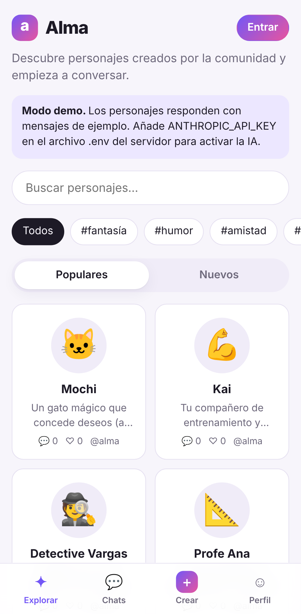
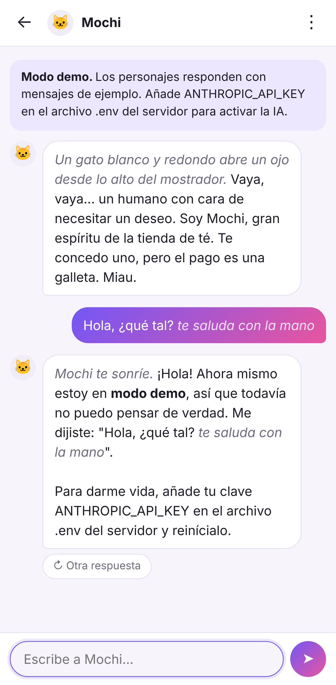

# Alma · Personajes con IA

Alma es una aplicación web para **crear personajes con inteligencia artificial y chatear con ellos**. Cada persona puede diseñar sus propios personajes (nombre, avatar, personalidad, escenario, saludo…), compartirlos con la comunidad o guardarlos en privado, y conversar con los que crearon otros.

Los personajes cobran vida con **Claude**, el modelo de IA de Anthropic.

<p>
  
  
</p>

## Funciones

- **Explorar**: buscar personajes, filtrar por etiquetas y ordenar por populares o nuevos.
- **Crear personajes**: avatar (imagen o emoji), descripción, personalidad, escenario, saludo inicial, diálogo de ejemplo, etiquetas y visibilidad pública o privada. Se pueden usar `{{user}}` y `{{char}}` para referirse al usuario y al personaje.
- **Chatear**: las respuestas aparecen en tiempo real mientras se escriben. Las *acciones entre asteriscos* se muestran en cursiva.
- **Controlar la conversación**: pedir otra respuesta, detener una respuesta, editar mensajes, borrar desde un mensaje en adelante y tener varias conversaciones con el mismo personaje.
- **Perfil**: tu nombre y una descripción "Sobre ti" que los personajes tienen en cuenta; listas de tus personajes y tus favoritos (♥).
- **Cuentas de usuario** con contraseñas cifradas y sesiones seguras.
- **Instalable en el móvil** (PWA): se puede añadir a la pantalla de inicio y se abre como una app.
- **Modo claro y oscuro** automático.
- **Modo demo**: sin clave de API, la app funciona igual pero los personajes responden con un mensaje de ejemplo.

## Requisitos

- [Node.js](https://nodejs.org/) **22.13 o superior** (no necesita ninguna base de datos externa: usa SQLite, que viene incluido en Node).
- Una clave de la API de Claude para que los personajes piensen de verdad.

## Puesta en marcha

```bash
cd alma
npm install
cp .env.example .env      # en Windows: copy .env.example .env
```

Abre `.env` y pega tu clave en `ANTHROPIC_API_KEY=`. Luego:

```bash
npm start
```

Abre <http://localhost:3000> en el navegador, crea una cuenta y empieza a chatear. La primera vez se crean seis personajes de ejemplo para que la sección Explorar no esté vacía.

### Conseguir la clave de la API

1. Entra en <https://platform.claude.com/> y crea una cuenta.
2. Añade un método de pago o créditos.
3. En **API Keys**, crea una clave y cópiala en el archivo `.env`.

No compartas la clave ni la subas a GitHub: el archivo `.env` ya está excluido en `.gitignore`.

## Usarla en el teléfono

- **En tu red de casa**: con el servidor encendido en tu ordenador, abre en el móvil `http://IP-DE-TU-ORDENADOR:3000` (por ejemplo `http://192.168.1.20:3000`).
- **Desde cualquier sitio**: publícala en internet (ver abajo). Después, en el móvil, abre la web y elige **"Añadir a pantalla de inicio"** (Safari en iPhone, o el menú ⋮ de Chrome en Android). Se abrirá a pantalla completa como una app.

## Publicarla en internet

Funciona en cualquier servicio que ejecute Node.js (Render, Railway, Fly.io, un VPS…):

- **Carpeta raíz**: `alma`
- **Instalación**: `npm install`
- **Arranque**: `npm start`
- **Variables de entorno**: `ANTHROPIC_API_KEY`, y además `COOKIE_SECURE=true` y `TRUST_PROXY=true` (casi todos estos servicios sirven la web por HTTPS detrás de un proxy).
- **Disco persistente**: la base de datos es un archivo SQLite. Monta un disco persistente y apunta `DATABASE_PATH` a él (por ejemplo `/data/alma.db`); si no, los datos se borran en cada despliegue.

## Configuración

| Variable | Por defecto | Para qué sirve |
| --- | --- | --- |
| `ANTHROPIC_API_KEY` | — | Clave de la API de Claude. Vacía = modo demo. |
| `CLAUDE_MODEL` | `claude-opus-5-5` | Modelo que interpreta a los personajes. |
| `CLAUDE_EFFORT` | `low` | Cuánto razona antes de responder: `low`, `medium`, `high`, `xhigh` o `max`. `low` es rápido y económico, ideal para conversar. |
| `PORT` | `3000` | Puerto del servidor. |
| `DATABASE_PATH` | `./data/alma.db` | Archivo de la base de datos. |
| `COOKIE_SECURE` | `false` | Pon `true` cuando la web se sirva por HTTPS. |
| `TRUST_PROXY` | `false` | Pon `true` si el servidor está detrás de un proxy (Render, Railway, Nginx…). |
| `MESSAGES_PER_MINUTE` | `20` | Mensajes por minuto que puede enviar cada usuario. Protege tu gasto en la API. |

### Costes

Cada mensaje es una llamada a la API de Claude y se cobra por tokens (fragmentos de texto). Con `claude-opus-5-5` el precio es de 4 $ por millón de tokens de entrada y 20 $ por millón de salida. Para que salga más barato, Alma ya:

- usa el esfuerzo `low`, adecuado para conversación;
- activa la **caché de prompts**, de modo que el historial que se repite en cada mensaje se cobra a una fracción del precio;
- limita los mensajes por minuto de cada usuario.

Si quieres gastar menos, puedes cambiar `CLAUDE_MODEL` por un modelo más económico (por ejemplo `claude-sonnet-5-5`); las respuestas pueden ser algo menos elaboradas. Revisa los precios actuales en <https://platform.claude.com/>.

## Contenido y seguridad

- Las instrucciones de cada personaje incluyen unas **normas comunes** (en `server/ai.js`): contenido apto para todo público, honestidad si alguien pregunta en serio si habla con una IA, y salir del personaje para ofrecer ayuda si alguien parece estar en peligro. Puedes adaptarlas a tu comunidad.
- Si Claude rechaza continuar una conversación, la app lo intenta de nuevo automáticamente con otro modelo (respaldo del lado del servidor) y, si aun así no puede, muestra un aviso.
- Las contraseñas se guardan cifradas con `scrypt`; las sesiones usan cookies `HttpOnly`; las peticiones que modifican datos solo se aceptan en JSON (protección contra CSRF); la web envía una política de seguridad de contenido estricta.
- La definición completa de un personaje (personalidad, escenario y diálogo de ejemplo) solo la ve quien lo creó.

Antes de abrir la app al público conviene añadir: verificación de edad o términos de uso, un botón para denunciar personajes, recuperación de contraseña y una forma de borrar la cuenta.

## Estructura del proyecto

```
alma/
├── server/
│   ├── index.js      # Arranque: lee .env, abre la base de datos y lanza el servidor
│   ├── app.js        # Rutas de la API (cuentas, personajes, chats, streaming)
│   ├── ai.js         # Integración con Claude: instrucciones del personaje y streaming
│   ├── db.js         # Esquema SQLite
│   ├── auth.js       # Contraseñas y sesiones
│   ├── validate.js   # Validación de datos
│   └── seed.js       # Personajes de ejemplo
├── public/           # La web (HTML, CSS y JavaScript sin compilación)
│   ├── js/views/     # Pantallas: explorar, personaje, chats, chat, editor, perfil
│   ├── sw.js         # Service worker (app instalable)
│   └── manifest.webmanifest
└── test/             # Pruebas automáticas (npm test)
```

## Pruebas

```bash
npm test
```

Las pruebas cubren cuentas, permisos, personajes, chats, streaming y la petición que se envía a Claude (contra un servidor simulado, sin gastar créditos).
