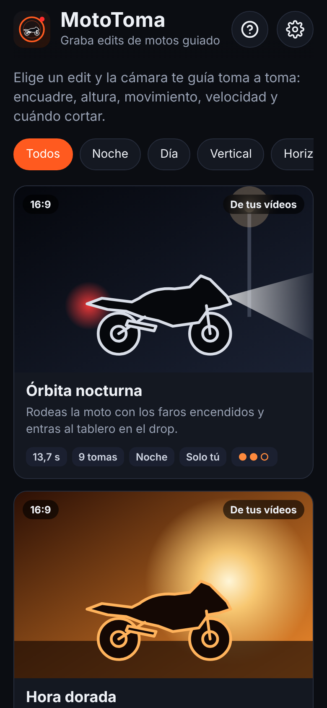
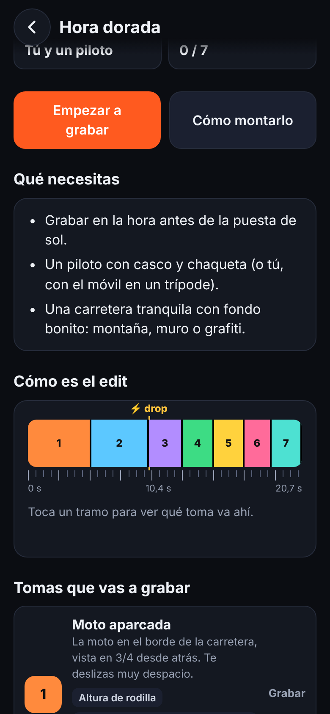
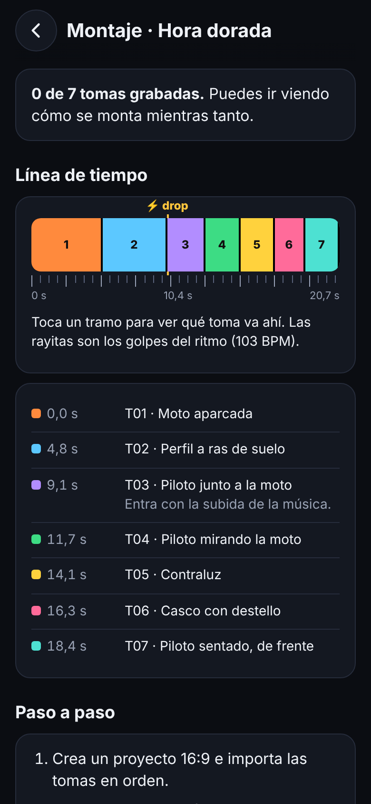
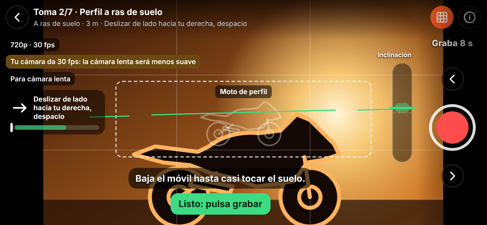

# MotoToma · Cámara guiada para edits de motos

MotoToma es una app de cámara para Android que te dice **cómo grabar** cada toma para conseguir edits de motos como los de TikTok o Reels. Eliges un edit del catálogo y la cámara te guía en tiempo real: dónde poner la moto, a qué altura, hacia dónde moverte, a qué velocidad y cuándo cortar. Tú montas el vídeo final en tu editor (CapCut u otro) con la guía de montaje que trae cada edit.

Funciona sin internet y sin coste: no usa ninguna API de pago.

<p>
  
  
  
</p>
<p></p>

## Instalar el APK

1. Copia `apk/MotoToma-1.0.apk` al móvil (o descárgalo desde GitHub en el móvil).
2. Ábrelo. Android pedirá permitir "instalar apps de origen desconocido" para tu navegador o gestor de archivos.
3. La primera vez que abras la cámara, acepta los permisos de cámara y micrófono.

Requiere Android 7.0 o superior.

## Catálogo

| Edit | Origen | Formato | Cuándo | Tomas |
|---|---|---|---|---|
| Órbita nocturna | Tu edit de CFMoto 450SR | 16:9 | Noche | 9 |
| Hora dorada | Tu edit de BMW S1000RR (con piloto) | 16:9 | Atardecer | 7 |
| Phonk oscuro | Tu edit de BMW S1000RR (cortes rápidos) | 16:9 | Noche | 8 |
| Chasquido POV | Tu edit de Kawasaki Ninja | 9:16 | Día | 5 |
| Giro infinito | Tu edit de Yamaha R7 | 9:16 | Día | 8 |
| El encendido | Clásico | 9:16 | Cualquiera | 6 |
| Transición con casco | Clásico | 9:16 | Día | 4 |
| Pasada rápida | Clásico | 16:9 | Día | 3 |

Los cinco primeros salen del análisis fotograma a fotograma de los edits que compartiste: dónde está cada corte, cuánto dura cada plano, el ritmo de la canción (BPM y drop), el tipo de plano, el movimiento de cámara y el color. Cada edit puede cambiarse entre vertical y horizontal.

## Qué hace la cámara

- **Recuadro de encuadre**: dónde debe quedar la moto y de qué tamaño.
- **Instrucciones en pantalla y por voz** en el momento justo de la toma ("camina hacia tu izquierda rodeándola…").
- **Inclinación**: barra a la derecha con la zona verde que pide la toma.
- **Horizonte**: línea que se pone verde cuando el móvil está recto.
- **Dirección y velocidad**: usa el giroscopio (órbitas y paneos) y el movimiento de la imagen (deslizamientos, subidas y bajadas). Avisa si vas al revés, muy rápido o muy lento.
- **Temblor y luz**: avisa si tiembla o si está demasiado oscuro.
- **Giro del móvil**: en el edit "Giro infinito" una aguja te marca cuánto girar en cada momento.
- **Transparencia**: muestra un fotograma de referencia encima de la cámara. Sale de dos sitios: del edit original si lo cargas en la ficha del edit (el vídeo no sale de tu móvil), o de una toma anterior cuando dos tomas tienen que coincidir (bucle o transición con casco).
- **Cuenta atrás, parada automática** cuando ya tienes los segundos necesarios, y **bloqueo de orientación** mientras grabas.
- **Revisión automática** de cada toma: duración, dirección, velocidad, temblor, inclinación y horizonte.
- **Guardado en la galería** en `Movies/MotoToma`, con nombres ordenados: `MotoToma_<edit>_T03_<toma>_<fecha>.mp4`.
- **Guía de montaje**: línea de tiempo con los golpes del ritmo y el drop, paso a paso para CapCut, ajustes de color y efectos.

## Desarrollo

Requisitos: Node.js 22, JDK 21 y el SDK de Android (plataforma 36).

```bash
cd mototoma
npm install
npm test            # pruebas del catálogo y de la guía
npm run dev         # versión web en http://localhost:5175 (la cámara funciona en localhost)
npm run icons       # regenera iconos y splash de Android
npm run apk         # compila www/, sincroniza Capacitor y genera el APK de depuración
```

El APK queda en `android/app/build/outputs/apk/debug/app-debug.apk`.

### Estructura

```
mototoma/
├── src/
│   ├── catalog.js      # los edits: tomas, línea de tiempo, color, montaje
│   ├── guide.js        # motor de la guía (sensores → avisos), sin DOM
│   ├── analyzer.js     # brillo y movimiento de la imagen
│   ├── camera.js       # cámara y grabación (getUserMedia + MediaRecorder)
│   ├── native.js       # puente con Android (voz, galería, orientación)
│   ├── art.js          # dibujos: portadas, iconos de encuadre, icono de la app
│   └── screens/        # inicio, detalle, cámara, montaje, ajustes, ayuda
├── public/             # index.html y estilos
├── android/            # proyecto Android (Capacitor 8)
│   └── app/src/main/java/com/enriquehurtado/mototoma/MotoNativePlugin.java
└── test/
```

### Añadir un edit nuevo

Cada edit es un objeto en `src/catalog.js`. Hay que rellenar las tomas (altura, movimiento, inclinación, recuadro, pasos con su segundo) y la estructura (qué toma va en cada tramo del vídeo final). `npm test` comprueba que la línea de tiempo sea continua y que cada toma tenga datos válidos.

## Limitaciones conocidas

- La guía no reconoce la moto en la imagen: te orienta con el recuadro, los sensores y el movimiento de la imagen.
- La altura del móvil no se puede medir; la app te la indica por texto.
- Si tu móvil no permite grabar MP4 desde la app, guarda en WebM. Los Android recientes graban en MP4 (H.264).
- La cámara lenta depende de que tu móvil dé 60 fps a la app; si no, verás un aviso.
- La voz durante la grabación queda en el audio del clip. Puedes desactivarla en Ajustes si quieres el sonido real limpio.
