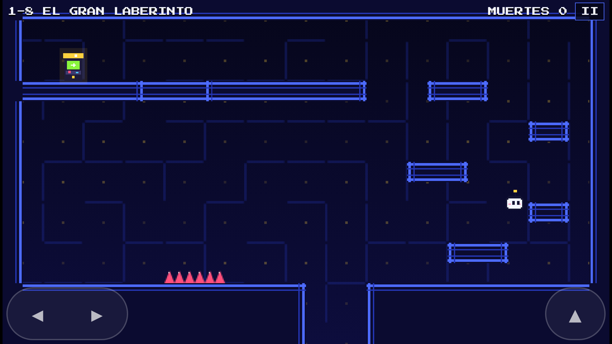
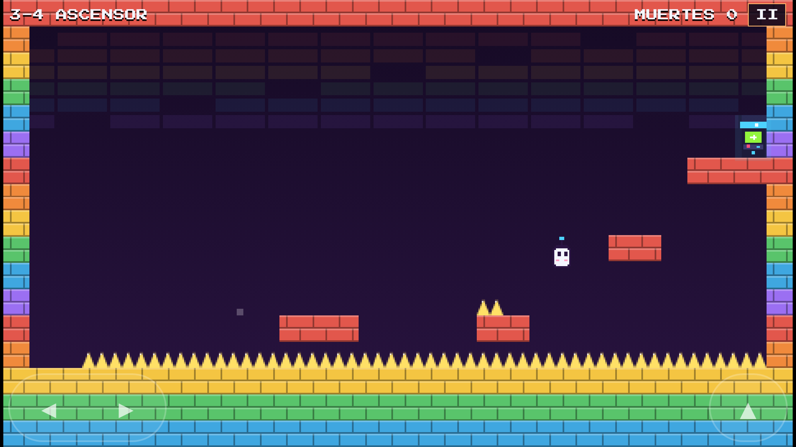

# Trampa Arcade

Juego de plataformas para Android lleno de **trampas sorpresa**: suelos que se caen, pinchos que aparecen, puertas que huyen, gravedad que se invierte… Tiene **40 niveles en 5 universos**, cada uno inspirado en un género arcade clásico. Se gana dinero con **anuncios** (AdMob) y con una **compra para quitarlos** (Google Play).

<p>
  
  
</p>

| Universo | Inspirado en | Trampas típicas |
| --- | --- | --- |
| 1. Laberinto Neón | juegos de laberintos | suelos que se caen, pinchos ocultos, bloques invisibles, puerta tímida |
| 2. Invasión Pixel | matamarcianos | bombas del cielo, aplastadores, plataformas falsas, techo que baja |
| 3. Muro de Ladrillos | rompeladrillos | muros que caminan, muelles, ascensores, controles al revés, turbo |
| 4. Vectorlandia | gráficos vectoriales | gravedad invertida, escaleras invisibles, pinchos de farol, asteroides |
| 5. Andamios Locos | juegos de andamios | barriles rodando, sierras, trampas que cambian cada intento |

Todo es original: el nombre, el personaje (“Bit”), los gráficos, la música (generada por código) y los niveles. Los fondos solo **evocan** los géneros arcade; no uses personajes con marca registrada (Pac-Man, los invasores de Space Invaders, Donkey Kong…) en un juego con anuncios: Google retira esas apps.

## Cómo está hecho

- **Juego**: JavaScript puro dibujado en un `<canvas>` de 480×272 píxeles (estilo pixel art), sin motor externo.
- **App Android**: [Capacitor 8](https://capacitorjs.com/) empaqueta el juego como app nativa (horizontal y pantalla completa).
- **Anuncios**: `@capacitor-community/admob` (banner en menús, anuncio entre niveles, anuncio con recompensa para saltar niveles y formulario de consentimiento para Europa).
- **Compras**: `@capgo/native-purchases` (Google Play Billing 9) para el producto “Quitar anuncios”.
- **Garantía de que se puede ganar**: un programa (`npm run verify`) juega solo cada nivel en sus intentos 1, 2 y 3 y guarda las soluciones; las pruebas (`npm test`) las reproducen.

## Probar el juego

Necesitas [Node.js](https://nodejs.org/) 22 o superior.

```bash
cd trampa-arcade
npm install
npm run dev        # abre http://localhost:5173 en el navegador
```

Controles en el ordenador: flechas o A/D para moverte, espacio/W/flecha arriba para saltar, Esc para pausar. En el móvil aparecen botones táctiles.

Otros comandos:

```bash
npm test           # pruebas automáticas (física, trampas y los 40 niveles)
npm run verify     # vuelve a resolver todos los niveles (tarda ~15 min). Úsalo si cambias niveles.
npm run android    # compila el juego y lo copia al proyecto Android
npx cap open android   # abre el proyecto en Android Studio
```

### En tu teléfono

1. Instala [Android Studio](https://developer.android.com/studio).
2. Ejecuta `npm run android` y después `npx cap open android`.
3. Conecta el móvil por USB (con la *depuración USB* activada) y pulsa ▶ **Run**.

También puedes instalar directamente un APK de prueba (`android/app/build/outputs/apk/debug/app-debug.apk`, se genera con `cd android && ./gradlew assembleDebug`). Android te pedirá permitir “instalar apps de origen desconocido”.

## Antes de publicar: configura el dinero

### 1. AdMob (anuncios)

Ahora mismo el juego usa los **anuncios de prueba oficiales de Google**: funcionan, pero no generan dinero. Para cobrar:

1. Crea una cuenta en [AdMob](https://admob.google.com/) y añade una app de Android (puedes vincularla con la de Google Play cuando la publiques).
2. Crea 3 **bloques de anuncios**: *Banner*, *Intersticial* y *Bonificado* (recompensa).
3. Copia el **ID de la app** (tiene `~`) en `android/app/src/main/res/values/strings.xml` → `admob_app_id`.
4. Copia los 3 **IDs de bloques** (tienen `/`) en `src/config.js` y cambia `useTestAds` a `false`.
5. En AdMob → **Privacidad y mensajes**, crea el mensaje de consentimiento para Europa (GDPR). El juego lo muestra solo cuando hace falta.
6. Ejecuta `npm run android` para aplicar los cambios.

> ⚠️ Nunca pulses tus propios anuncios reales: AdMob puede cerrar tu cuenta. Para probar, deja `useTestAds: true` o registra tu móvil como dispositivo de prueba en AdMob.

Cómo se muestran los anuncios (ajustable en `src/config.js`):
- **Banner**: solo en los menús, nunca mientras juegas.
- **Intersticial**: como mucho cada 3 niveles superados y cada 2 minutos.
- **Bonificado**: el jugador puede ver un anuncio para **saltar un nivel** (se le ofrece tras 8 muertes en el mismo nivel, o desde la pausa).

### 2. Google Play (compra “Quitar anuncios”)

1. Crea una cuenta de desarrollador en [Google Play Console](https://play.google.com/console) (pago único de 25 USD) y un **perfil de pagos** para poder vender.
2. Crea la app y sube una primera versión a **Prueba interna** (los productos solo se pueden crear cuando hay una versión subida con permiso de compras; esta ya lo tiene).
3. Ve a **Monetizar con Play → Productos → Productos únicos** y crea uno con el ID **`quitar_anuncios`** (o cambia `removeAdsProductId` en `src/config.js`). Ponle precio (por ejemplo 1,99 €) y actívalo.
4. Para probar sin pagar: **Configuración → Pruebas de licencias**, añade tu correo e instala la app desde el enlace de prueba interna.

Quien compra deja de ver banners e intersticiales y puede saltar niveles gratis. La compra se restaura sola al reinstalar (y desde *Ajustes → Restaurar compras*).

### 3. Política de privacidad

Google Play la exige porque hay anuncios.

1. Abre `legal/privacidad.html` y rellena lo que está entre corchetes (tu nombre, correo y fecha).
2. Publícala gratis con **GitHub Pages**: en este repositorio, *Settings → Pages → Deploy from a branch*. Quedará en una dirección como `https://enrique-hurtado382.github.io/Enrique-Hurtado382/trampa-arcade/legal/privacidad.html`.
3. Pon esa dirección en `src/config.js` (`privacyPolicyUrl`) y en Play Console.

## Publicar en Google Play

### Firmar la app

Google exige que la app vaya firmada con tu **clave de subida**. La forma más fácil:

1. En Android Studio: **Build → Generate Signed App Bundle or APK → Android App Bundle**.
2. Pulsa **Create new…**, guarda el archivo `.jks` en un lugar seguro **fuera del repositorio** y apunta las contraseñas. Si lo pierdes tendrás que pedir a Google que lo restablezca.
3. Elige *release* y termina. Obtendrás `app-release.aab`.

Desde la terminal también se puede: crea `android/keystore.properties` (ya está excluido de Git) con

```properties
storeFile=/ruta/a/tu/clave-subida.jks
storePassword=TU_CONTRASEÑA
keyAlias=subida
keyPassword=TU_CONTRASEÑA
```

y ejecuta `npm run android && cd android && ./gradlew bundleRelease`.

Cada vez que publiques una actualización, sube `versionCode` (1, 2, 3…) y `versionName` en `android/app/build.gradle`.

### Ficha de la tienda

En la carpeta `store/` tienes listo:
- `icono-512.png` — icono de la ficha.
- `grafico-destacado-1024x500.png` — gráfico destacado.
- `captura-*.png` — 6 capturas (1920×1080). Se regeneran con `node scripts/store-screenshots.cjs` (con `npm run dev` en marcha); el icono y el gráfico, con `node scripts/make-icons.cjs`. Ambos scripts necesitan Playwright (`npm install -D playwright && npx playwright install chromium`).

Texto sugerido:
- **Título**: Trampa Arcade
- **Descripción breve**: Plataformas con trampas sorpresa en 5 universos arcade. ¡Nada es lo que parece!
- **Descripción**: ¿Crees que el suelo es de fiar? Piénsalo dos veces. Trampa Arcade es un juego de plataformas donde cada nivel esconde una sorpresa: suelos que se derrumban, pinchos que aparecen de la nada, puertas que salen corriendo y gravedad que se da la vuelta. Recorre 40 niveles en 5 universos inspirados en los clásicos arcade, aprende de cada caída y demuestra que nadie te engaña dos veces… o tres. Controles sencillos, partidas rápidas y mucho humor.

### Formularios de Play Console

- **Anuncios**: marca que la app **contiene anuncios**.
- **Público objetivo**: recomendado **13 años o más** (si eliges menores entran normas extra de “Diseñado para familias”).
- **Seguridad de los datos**: declara lo que recoge el SDK de anuncios de Google — *identificadores del dispositivo* (ID de publicidad), *actividad en la app* e *información y rendimiento de la app*, compartidos con Google con fines de publicidad y analítica. Google lo explica en su guía “Divulgación de datos del SDK de Google Mobile Ads”. Las compras las procesa Google Play.
- **Clasificación de contenido**: responde el cuestionario con sinceridad (el personaje “muere” con pinchos, sin sangre).
- **Cuentas personales nuevas**: según las reglas actuales de Google, antes de publicar en producción debes hacer una **prueba cerrada con al menos 12 personas durante 14 días**. Compruébalo en tu Play Console, porque Google cambia estos requisitos.

## Crear más niveles

Los niveles están en `src/game/levels/` (un archivo por universo). Cada nivel es un mapa de **30×17** caracteres:

| Carácter | Significado |
| --- | --- |
| `.` | vacío |
| `#` | bloque sólido |
| `P` | inicio del jugador |
| `D` | salida (máquina arcade) |
| `^` `v` `<` `>` | pinchos (arriba, abajo, izquierda, derecha) |
| `x` | bloque invisible (aparece al golpearlo desde abajo) |
| `~` | bloque falso (parece sólido, no lo es) |
| `=` | muelle (impulsa casi 7 casillas) |
| `*` | sierra |
| `a`…`z` (salvo `v` y `x`) | bloques de un **grupo** que las trampas pueden mover, tirar u ocultar |
| `1`…`9` | pinchos de un grupo, ocultos hasta que una trampa los muestre |

El personaje salta **3 casillas de alto** (sube cómodamente 2) y unas **4 de largo**.

Cada trampa tiene una condición `when` y unas acciones `do`:

```js
{ when: { px: [10, 12] }, do: { fall: 'a' } }                 // al pasar por las columnas 10-12, el grupo a se cae
{ when: { near: 2.5 }, do: [{ doorTo: [3, 7] }, { say: '¡Por aquí no!' }] }
{ when: { ground: 'b' }, do: { fall: 'b', delay: 0.3 } }      // se cae 0,3 s después de pisarlo
{ when: { time: 1 }, attempts: [2], do: { shoot: { x: 30, y: 13, vx: -8, kind: 'barrel' } } }
```

- **Condiciones**: `px`/`py` (columnas/filas donde está el jugador), `near` (distancia a la salida), `time` (segundos), `jumps` (número de saltos), `air` (en el aire), `ground` (pisando un grupo), `after` + `delay` (después de otra trampa con `id`). Con `attempts: [mín, máx]` la trampa solo actúa en esos intentos.
- **Acciones**: `fall` (con `land: true` se queda en el suelo), `vanish`, `appear`, `move` (`dx`, `dy`, `speed`, `pingpong`), `door` (la salida se desplaza), `doorTo` (se teletransporta), `gravity` (1 o -1), `reverse` (controles al revés), `speedMul` (turbo), `shoot` (bomba, bola, barril, sierra o bloque), `shake`, `say` (mensaje).

Después de crear o cambiar niveles ejecuta `npm run verify` para comprobar que se pueden ganar.

## Estructura

```
trampa-arcade/
├── src/
│   ├── main.js            # menús, bucle de juego, anuncios, compras, guardado
│   ├── config.js          # ⚙️ IDs de AdMob, producto de compra y política de privacidad
│   ├── game/
│   │   ├── sim.js         # física y trampas (sin gráficos, se puede probar en Node)
│   │   ├── render.js      # dibujo de fondos, bloques, personaje y efectos
│   │   ├── universes.js   # los 5 universos: colores, fondos y música
│   │   ├── solver.js      # el "jugador automático" que verifica los niveles
│   │   └── levels/        # los 40 niveles
│   ├── engine/            # sonido chiptune y controles
│   └── platform/          # AdMob, Google Play Billing y guardado
├── public/                # HTML y CSS de la interfaz
├── android/               # proyecto nativo de Android (Capacitor)
├── store/                 # icono, gráfico destacado y capturas para Google Play
├── legal/privacidad.html  # plantilla de política de privacidad
└── test/                  # pruebas automáticas y soluciones de los niveles
```

## Licencias de terceros

- Fuente **Press Start 2P** de CodeMan38 — SIL Open Font License 1.1.
- Capacitor y sus plugins — licencias MIT.
